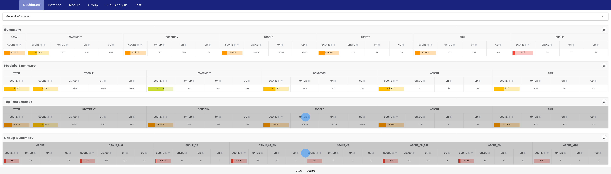

# UVS baseline (reference for VCS parity)

Captured on 2026-11-03 from the same source tree that ships in this VCS package.

- Tool: UVS 2026.06.P2.Beta
- Command: `JOBS=16 bash scripts/run_all_uvs.sh`
- Plan: `scripts/regression/test_plan.yaml` (47 entries, 200 runs)
- Result: **190 PASS / 200**, 10 FATAL

## Known failing runs (pre-existing RTL hangs, not migration regressions)

```
t022_l2_simultaneous_flush_miss seed=1..3
t045_l2_simultaneous_flush_miss seed=1..3   (plan duplicate entry)
t033_l2_power_flush             seed=1..3
t034_l2_power_domain_iso        seed=1
```

All 10 failures end with `TB_TOP: Simulation timeout at 10000000000`; the RTL
does not complete the scenario. The VCS baseline documented in
`docs/uvs_migration_report.md` had the same failure set.

## Coverage

`coverage_summary.json` is extracted from
`reports/coverage/merged/data/coverage.json` after merging 200 run DBs plus the
compile-time DB:

| metric | score |
|---|---:|
| stmt   | 42.84 |
| cond   | 26.48 |
| tgl    | 25.88 |
| assert | 29.69 |
| fsm    | 23.26 |
| group  | 13.00 |
| total (equal weights) | 26.86 |



VCS/URG percentages will not be bit-identical (different counting rules and
instrumentation scopes). Compare metric-by-metric and use the same merged
run list; the VCS mapping is:

```
UVS -cov stmt,cond,fsm,tgl,assert,group
  -> VCS -cm line+cond+fsm+tgl+branch+assert
     (UVS stmt covers branches; VCS collects covergroups by default)
```
